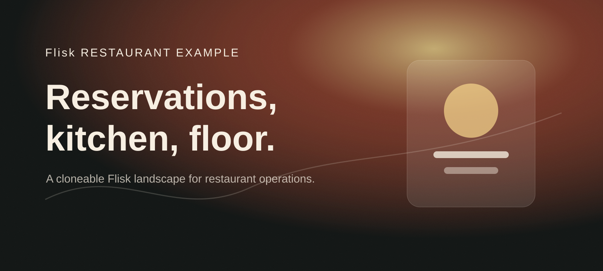
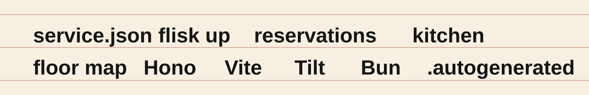
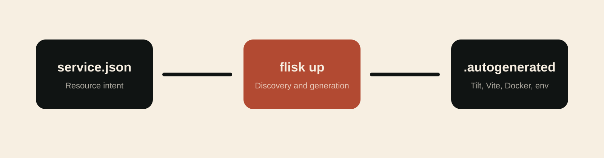

<!-- markdownlint-disable MD013 MD033 MD041 -->

[](https://github.com/flisk-sh/flisk)

<p align="center">
  
</p>

<p align="center">
  <a href="#run-it">Run it</a>
  &nbsp;&nbsp;/&nbsp;&nbsp;
  <a href="#the-landscape">Explore the landscape</a>
  &nbsp;&nbsp;/&nbsp;&nbsp;
  <a href="#generation">Understand generation</a>
  &nbsp;&nbsp;/&nbsp;&nbsp;
  <a href="#demo-walkthrough">Demo Walkthrough</a>
  &nbsp;&nbsp;/&nbsp;&nbsp;
  <a href="https://github.com/flisk-sh/flisk">Flisk CLI</a>
</p>

<br>

## Restaurant Operations in One Clone

This repository is a polished Flisk **Project-Stack-Resource (PSR)** example for restaurant teams: reservations, waitlist intake, kitchen throughput, menu availability, and floor control split into independently runnable resources.

You declare each restaurant service in a compact `service.json`. Flisk discovers the landscape, resolves resource dependencies, allocates ports, and generates local Docker, Vite, environment, and TypeScript plumbing inside `.autogenerated/`.

<p align="center">
  
</p>

> ⭐ **This project runs on [Flisk CLI](https://github.com/flisk-sh/flisk).** If it saves you time, [star flisk on GitHub](https://github.com/flisk-sh/flisk) so other developers can find it.

## Run It


> **Repository-pinned CLI (optional):** Run `bun install` from the repository root to install the version pinned in `package.json`. Use `bun run flisk:project` to initialize project config, `bun run flisk:dry-run` to preview startup, or `bun run flisk:up -- <stack>` to start a stack. The global npm and standalone binary installation paths remain available.

### Prerequisites

- [Docker](https://docs.docker.com/get-docker/) is running.
- [Tilt](https://docs.tilt.dev/install.html) is installed.
- [Bun 1.2+](https://bun.sh/docs/installation) is installed.
- [Flisk CLI](https://github.com/flisk-sh/flisk#installation) is available as `flisk`.

```bash
git clone https://github.com/flisk-sh/flisk-restaurant-example.git
cd flisk-restaurant-example
flisk up
```

Flisk starts all three stacks from their resource manifests.

```bash
# Start one restaurant domain stack
flisk up guest
flisk up kitchen
flisk up operations

# Inspect the running landscape
flisk status

# Stop the landscape
flisk down
```

## The Landscape

<p align="center">
  
</p>

| Stack | Resource | Type | Runtime | Port | Dependencies | Primary Capability |
| --- | --- | --- | --- | ---: | --- | --- |
| **guest** | [`reservation-api`](services/guest/reservation-api) | Backend API | Hono 4 / Bun | [`4100`](http://localhost:4100/health) | None | Reservations, waitlist, and table holds |
| **guest** | [`restaurant-migrator`](services/guest/restaurant-migrator) | Migrator | Prisma migrate / Postgres | None | `postgres` | Creates and seeds the restaurant tables (`Flisk_restaurant`) |
| **guest** | [`reservation-app`](services/guest/reservation-app) | Frontend App | Vite 5 / React | [`3100`](http://localhost:3100) | `reservation-api` | Guest booking and host stand screen |
| **kitchen** | [`kitchen-api`](services/kitchen/kitchen-api) | Backend API | Hono 4 / Bun | [`4110`](http://localhost:4110/health) | None | Tickets, stations, and service pacing |
| **kitchen** | [`kitchen-worker`](services/kitchen/kitchen-worker) | Background Worker | Bun Worker | [`4111`](http://localhost:4111/health) | `kitchen-api` | Ticket aging and course-fire signals |
| **operations** | [`menu-api`](services/operations/menu-api) | Backend API | Hono 4 / Bun | [`4120`](http://localhost:4120/health) | None | Menu availability, modifiers, and item 86s |
| **operations** | [`floor-app`](services/operations/floor-app) | Frontend App | Vite 5 / React | [`3120`](http://localhost:3120) | `menu-api`, `reservation-api` | Floor map and nightly operations view |

```text
flisk-restaurant-example/
├── Tiltfile
├── TILT_SERVICE_DEFAULTS.star
├── TILT_TECH_STACK.star
├── DEMO_GUIDE.md
├── docs/
│   ├── readme-hero.svg
│   ├── readme-marquee.svg
│   ├── readme-bento.svg
│   └── readme-flow.svg
└── services/
    ├── guest/
    │   ├── reservation-api/
    │   └── reservation-app/
    ├── kitchen/
    │   ├── kitchen-api/
    │   └── kitchen-worker/
    └── operations/
        ├── menu-api/
        └── floor-app/
```

## Generation

<p align="center">
  
</p>

Every restaurant resource owns a compact declarative manifest:

```json
{
  "appName": "reservation-api",
  "appType": "backend",
  "stack": "guest",
  "port": 4100,
  "dependsOn": [],
  "healthCheck": {
    "enabled": true,
    "path": "/health"
  }
}
```

Running `flisk up` turns those manifests into local orchestration files for Tilt, Docker, Vite, and Bun.

> [!IMPORTANT]
> Edit `service.json`, `TILT_SERVICE_DEFAULTS.star`, or `TILT_TECH_STACK.star`. Never edit `.autogenerated/` directly; Flisk regenerates its contents.

## Project, Stack, Resource

| Level | Meaning in Flisk Restaurant Operations | Command Surface |
| --- | --- | --- |
| **Project** | The entire restaurant demo landscape | `flisk up`, `flisk down`, `flisk status` |
| **Stack** | A restaurant business area: `guest`, `kitchen`, or `operations` | `flisk up guest` |
| **Resource** | One API, web console, or worker process | `flisk resource <name> ...` |

## Demo Walkthrough

Open [DEMO_GUIDE.md](DEMO_GUIDE.md) for a three-minute walkthrough that shows how a host stand, kitchen pass, and manager floor view can be split into Flisk resources without hand-wiring local orchestration.

## Plan the Work: GitHub Project Template

[docs/PROJECT_TEMPLATE.md](docs/PROJECT_TEMPLATE.md) walks through building **Flisk Delivery**, an organization project template, in the GitHub UI. It tracks every item by Stack, Resource, Phase, Priority, and Sprint, and matches the issue forms in `.github/ISSUE_TEMPLATE/`.

## Data

All four APIs share one Postgres database, `Flisk_restaurant`. `restaurant-migrator` owns the schema: it runs
`prisma migrate deploy` over [`services/guest/restaurant-migrator/prisma/migrations`](services/guest/restaurant-migrator/prisma/migrations),
and the APIs start only after it finishes. The first migration creates the tables; the second seeds them with fixed
ids and `on conflict do nothing`, so re-running the migrator changes nothing.

| Table | Owned by | Read and written by |
| --- | --- | --- |
| `menu_items` | `menu-api` | menu, 86 list, `PATCH /api/v1/menu-items/:id` |
| `floor_tables` | `menu-api` | floor; a table's status is derived from its reservations |
| `reservations` | `reservation-api` | bookings, waitlist, cancel, seat |
| `kitchen_stations`, `kitchen_tickets` | `kitchen-api` | tickets and stations; seating queues a ticket, `kitchen-worker` marks queued tickets done |

APIs use Bun's built-in SQL client with `DATABASE_URL` from the environment, the same pattern as the Flisk demo Board.
Seating a party writes its kitchen ticket in the same transaction, so the pass sees it at once.

## Testing Individual Resources

Each resource is standalone and testable:

```bash
cd services/guest/reservation-api
bun install
bun run typecheck
```

---

<p align="center">
  <strong>Declare the restaurant. Generate the landscape. Keep service moving.</strong>
</p>

<p align="center">
  <a href="https://github.com/flisk-sh">Flisk</a>
  &nbsp;&nbsp;/&nbsp;&nbsp;
  <a href="https://github.com/flisk-sh/flisk">CLI</a>
  &nbsp;&nbsp;/&nbsp;&nbsp;
  <a href="DEMO_GUIDE.md">Demo Guide</a>
  &nbsp;&nbsp;/&nbsp;&nbsp;
  MIT License
</p>
